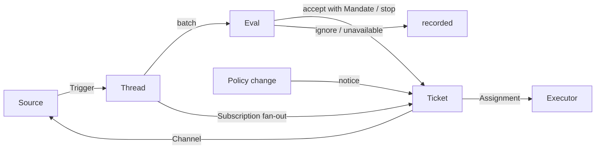

# 001 领域模型

本文档命名 dsh-superagent 的概念以及各自遵守的规则。代码、智能体调用的工具、面板及其他文档仅使用这些术语。遵循 [000 哲学](000-philosophy.md)，模型只保留工作所需的概念，业务需求成为其中某一概念的属性。

## 流程

工作从 Trigger 经 Eval 到执行。事件源（Source）产生 Trigger。Trigger 作为上下文扇出到订阅其 Thread 的工作项（Ticket）。经此路径到达工作项的人员消息留在该工作项上；其余 Trigger 进入 Eval，由 Eval 决定是否请求新工作。Eval 接受时，创建工作项并附带 Mandate。Assignment 将工作项交给 Executor，结果经 Channel 回到事件源。

## 概念

事件源、Thread、Eval、Mandate 与 Subscription 构成核心领域；其余概念支撑它们。

| 概念 | 定义 | 遵守的规则 | 存在原因 |
| --- | --- | --- | --- |
| Source（事件源） | 事件流。Source 种类是可复用的实现；Source 实例是某种类的一份配置：是否运行以及监听什么 | 持有读取位置与自身 bot 身份。定义何谓事件，包括仅在一段时间内成立的条件。在进入领域前丢弃 bot 自身消息及监听范围外的 Trigger。将每个 Trigger 翻译为其所属 Thread 与回复用的 Channel 地址 | 重启不得重放事件 |
| Trigger | 一条不可变事件，带事件源自有元数据（如 actor） | 属于一个或多个 Thread。同一 Trigger 接受两次只创建一个工作项 | 审计与幂等的单位 |
| Thread | 按时间排序的 Trigger；事件源定义哪些 Trigger 构成一条 Thread | 同一时刻最多一个 Eval 在其上运行。可有多个工作项。持有 Subscription、进行中的 Eval 及其 Decision 历史 | 为 Eval 提供一致视图与上下文 |
| Correlation | 同一 Trigger 所属多条 Thread 之间的关系 | 仅添加上下文；从不用于路由 | 让 Eval 跟踪相关证据 |
| Channel | Thread 的写入侧；事件源定义其地址 | 一条 Thread 可有多个 Channel；工作项持有一组 Channel | 确认、回复、拉取请求与已解决 review 均为写入 |
| Policy | 版本化的评估规则及各事件源部分：谁可通过该事件源、以该事件源身份发起工作、名单如何同步、哪些 bot 可产生候选 | Policy 版本覆盖规则、accept 模式与事件源部分。影响在途工作项的变更（如其接受所依据的规则变更）送达其 Assignment；不撤销 Mandate。不同事件源上的身份彼此不做映射 | 规则变更时必须丢弃进行中的 Eval |
| Eval | 对一批 Trigger 的判定，分两层：gate 与 assessment | 输入：Trigger 批次、Thread 快照、该 Thread 上全部工作项（含已结束）、当前 Policy。输出：Decision。不持有状态 | 决定新工作是否开始、继续或停止 |
| Mandate | accept 所授予的内容：Policy 版本、scope、strength、匹配规则、发送者在事件源上的身份及事件源如何接收 Trigger | 不可变；更宽 scope 意味着新工作项。工作项结束不结束 Mandate：仅人员 stop 撤回，Policy 不再成立则撤销。已结束工作项恢复前按当前 Policy 重新校验 | 说明工作为何可做、可做到何种程度 |
| Ticket（工作项） | 一个授权工作单元 | 仅 Eval 创建。引用其 Mandate；持有 Channel 与 Input。open → ended，人员在其 Thread 上消息可恢复为 open，除非人员已 stop。定义自身状态，不跟随 Executor | 拥有执行与报告 |
| Assignment | 工作项与一个 Executor 实例的绑定 | 一个工作项历史上可有多个。pending → running → ended，与工作项独立。仅最终 report 可在 Executor 侧结束工作项 | Executor 在领域外，但谁执行必须在领域内 |
| Subscription | 工作项与 Thread 的多对多关系，由 Thread 持有 | 匹配的 Trigger 扇出到每个在订的工作项，不检查发送者；人员消息经此到达工作项时不走 Eval。Executor 为上下文跟进的 Thread 以同样方式到达工作项，但不授予权限、不恢复。已结束工作项保留 Subscription，含已关闭或合并的 PR 对应 Thread：人员消息在同一 Mandate 下恢复，无 Eval 或 Decision；bot 与 CI 消息不到达，因其 Executor 恢复时再次读取 Thread。人员 stop 的工作项不再接收任何内容。主 Session 仅在消息明确指向某工作项时，将 Thread 挂到已有工作项。人员可去掉 Thread 上全部 Subscription；Executor 仅可去掉本工作项对无关 Thread 的 Subscription，除工作项起始 Thread 及事件源要求其跟进的 Thread（如其 PR） | 后续讨论到达 Executor，无需再 @ 智能体 |

人员不是领域概念。Trigger 携带 actor 标识，由事件源提供。允许名单是 Policy 中事件源部分，使用该事件源身份。同一人拥有多个事件源账号属于 prompt 文本，智能体需要时阅读。

Executor 及其 Session、目录在领域外，通过 Assignment 连接。

聚合：事件源持有读取位置。Thread 持有 Subscription、进行中的 Eval（串行运行，期间到达的 Trigger 合并进下一批）及 Decision 历史。工作项持有 Assignment、Channel、Input，并以 id 引用 Decision。

## 已拒绝的概念

| 已拒绝 | 原因 |
| --- | --- |
| Principal 或 Membership 作为实体，或跨事件源映射身份 | 人员是 Trigger 元数据；允许名单是 Policy 中事件源部分；跨事件源映射是 prompt 文本 |
| Eval 自行调度延迟 Trigger | 需要等待的条件是普通事件源，Eval 不反向依赖事件源 |
| waiting 或 revoked 的 Eval 状态 | 等待属于事件源；Eval 超时将 Trigger 重新入队，或结束为 `unavailable` |
| 每条 Thread 最多一个在途工作项 | 一条 Thread 可承载多项独立工作；assessment 靠工作项列表避免重复 |
| “append 到工作项”类 Decision | append 是 Subscription 扇出，无需 Eval |
| Subscription 上的准入检查 | Subscription 覆盖整条 Thread；Mandate 将授权与上下文分开 |
| 用于路由的 Correlation | Subscription 路由；Correlation 仅添加上下文 |
| 跟随 DSH Session 的工作项状态 | 工作项可交接、恢复或由多个 Executor 执行，故定义自身状态 |
| Executor 声明人员要求其 stop | 仅 Eval 决定 end 的 strength |
| Policy 变更时取消在跑工作项 | 取消变更会留下半成品；改为记录并送达变更 |
| Executor Session 失败或阻塞时锁定全部工具 | 会拒绝人员直接在 Session 中工作及恢复后的 report；暂停自动输入即可 |
| 从 report 自由文本推断“等待人员” | 分类需要结构化事实；Executor 通过结构化字段询问 |

## 可复用部分

上述概念及其规则可复用。事件源实现、Policy 内容、Executor 与 Channel 实现属于部署。各事件源内部保留自有用词（如 message、chat、notification），并翻译为 Trigger。

| 部分 | 本仓库中 |
| --- | --- |
| Source | 飞书：实时事件、历史恢复、已订阅主题轮询。GitHub：通知、已订阅 Issue 与 PR、CI 变更、合并或关闭的 PR，以及（开启时）仓库内每个新 Issue、PR、评论及默认分支 CI |
| Policy | 评估规则，及各事件源的允许名单、同步、bot 列表与 admission 表 |
| Executor | 每个工作项一个 DSH Executor Session 与一个目录，位于 Executor 与事件源注册变量的执行环境中 |
| Channel | 飞书话题回复、GitHub 评论与 review thread 回复 |

## 术语表

本文件及后续文档所用术语参考列表及中文名；后续文档解释上文未引入的术语。面板一次只显示一种语言；(?) 按钮打开本术语表并显示双语。智能体在 GitHub 与飞书上发给人员的消息使用 plain language，不用这些术语。

| Term | 中文 | 含义 |
| --- | --- | --- |
| Agent | 智能体 | dsh-superagent 运行的自动化团队成员，通过 GitHub 账号、飞书 bot 等身份在事件源上行动 |
| Main Session | 主 Session | 评估 Trigger、accept 与 dispatch 工作项并回复的 DSH Session；代码与 prompt 中为 `orchestrator` |
| Executor Session | 执行器 Session | Executor 为单个工作项运行的 DSH Session；代码与 prompt 中为 `worker` |
| Source | 事件源 | 事件流：插件提供的 kind 加一份实例配置 |
| Trigger | 触发 | 事件源的一条不可变事件 |
| Thread | 线程 | 按时间排序的 Trigger；Eval 串行运行的单位 |
| Correlation | 关联 | 共享 Trigger 的 Thread 之间的关系；仅添加上下文 |
| Channel | 渠道 | Thread 的写入侧 |
| Policy | 策略 | 接受工作的版本化规则，及各事件源部分（如谁可在该处请求工作） |
| Policy version | 策略版本 | 规则、事件源部分与 accept 模式某一组合的标识；每个 Mandate 记录它 |
| Eval | 评估 | 将一批 Trigger 变为 Decision 的过程 |
| Gate | 准入 | Eval 的确定性第一层：谁可发起工作及 strength |
| Assessment | 研判 | Eval 中模型的判断 |
| Decision | 决定 | Eval 的结果 |
| Mandate | 授权 | accept 授予的内容：strength、scope 及所依据 Policy 版本 |
| Ticket | 工作项 | 一个授权工作单元 |
| Assignment | 派工 | 工作项与一个 Executor 实例的绑定 |
| Subscription | 订阅 | 工作项与 Thread 的关系 |
| Fan-out | 扇出 | 将已订阅 Thread 的 Trigger 作为上下文送达工作项 |
| Executor | 执行器 | 运行 Assignment 的端口：每个工作项一个 Executor Session 与一个目录 |
| Execution environment | 执行环境 | Executor Session 与 prepare 命令运行处：Executor 与事件源注册的变量，各含 key、value、description |
| Report | 报告 | Assignment 向工作项报告的状态 |
| Attention | 待人工决定 | 工作项上等待人员回答的问题 |
| Disposition | 去向 | Trigger 被过滤、评估或扇出的记录 |
| Input | 输入 | 送达工作项的上下文：扇出 Trigger、Policy 变更、恢复与文本 |
| Scope | 范围 | Mandate 允许的工作 |
| Strength | 强度 | Mandate 或 Eval 依据的强度 |

| Group | Values |
| --- | --- |
| Decision | accept 接单 · stop 停止 · ignore 忽略 · unavailable 未完成 |
| Strength | explicit 明确 · inferred 推断 |
| Assignment | pending 待启动 · running 执行中 · ended 已结束 |
| Report | progress 进展 · waiting 等待 · ready 就绪 · blocked 受阻 · failed 失败 · dropped 无需处理 |
