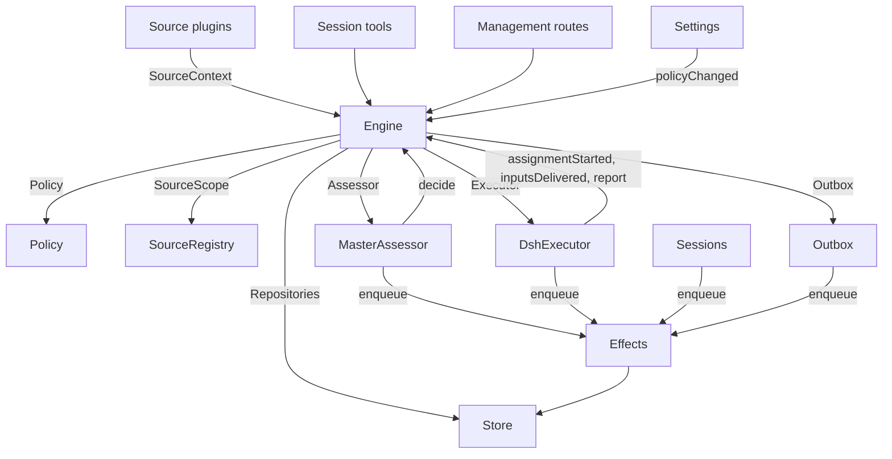

# 007 架构

本文是面向开发者的实现指南。它将 [001 领域模型](001-domain.md) 至 [006 部署](006-deployment.md) 中的概念映射到类、接口与文件。先从运行时与 Engine 入手，再以模块表与测试表作为代码索引。

## 核心类与胶水层

核心类在小型接口背后持有领域概念与外部边界。胶水层将工具参数、HTTP 请求、Source 载荷与 DeepSeek Harness 事件翻译为对这些类的调用，再将结果转为卡片、视图与消息。

`Runtime`（`src/app/runtime.ts`）构造应用、提供依赖，并负责启动与关闭。`Engine` 自行构造内部部件。Executor 与 Assessor 会回调 Engine，因此 Runtime 通过 getter 而非循环依赖顺序来提供它们。

### Runtime

`Runtime` 是组合根；不含领域规则。其构造函数锁定状态目录、打开 Store 并构建各组件。若构造失败，则关闭 Store 并释放锁。

启动时注册管理路由并运行 Setup。setup 完成后，安装 Session 与 Executor 钩子、确保主 Session 存在、启动 Policy 同步、恢复被中断的 Assignment，并启动 pass 与 effects。`ready` 标记启动完成。

关闭时取消 turn、等待 pass、effects 与 agent，恢复进程环境、关闭 Store 并释放锁。Source 插件通过窄接口 `SourceHost` 将 Runtime 作为 `orchestrator` 服务注入。

| 部件 | 模块 | 职责 |
| --- | --- | --- |
| Setup | `src/app/setup.ts` | 以 worker shell 运行 CLI 的方式探测仓库与账号，写入并应用 worker 环境与命令 shim，并维护 setup 问题；Settings 通过它检查变更的账号并通过它重启（会再次运行 setup） |
| Passes | `src/app/passes.ts` | 同一时间仅一个 pass，每两秒及在命令请求时：到期的 effects，然后 `Engine.evaluateDue`；Source 的 Trigger 经此到达 Engine |
| Outbox | `src/app/outbox.ts` | Engine 的 `Outbox` 端口，也是 receipt 的唯一写入者：`send` 在一笔事务中保留消息的 receipt 并排队其 `reply` effect，effect 处理器经 `SourceRegistry.send` 发送；Source 关闭时消息等待；会话消失或未监听时丢弃 |
| Notices | `src/app/notices.ts` | 将领域事件与 worker 活动转换为主 Session 消息。`eventNotice` 处理领域通知；`reportRelay` 立即转发问题，在 Ticket 上保留普通进度并中继其他 report；`followupRelay` 命名拥有人工跟进项的 Ticket。turn 期间到达的中继在 DeepSeek Harness inbox 的下一步一并投递 |

### Engine

`Engine`（`src/core/engine.ts`）是 Trigger、Thread、Decision、Ticket 与 Assignment 的唯一写入者。它从 `src/core/ports.ts` 接收这些端口：`Repositories`、当前 Policy 的 getter、`SourceScope`、`Assessor`、`Executor` 与 `Outbox`。可选依赖为 `prepareTicket`、`now` 与 `emit`。

所有 Engine 方法均为同步。每条命令在一笔事务中变更其聚合。`evaluateDue` 对变更的每个 Eval 或 Ticket 使用独立事务。端口在事务内排队外部工作；适配器在提交后执行。无效请求抛出 `UserError`。

Engine 暴露单一入口并委托给五个内部部件。它拥有每条命令的事务。跨部件的命令（如 `attach`、`evaluateDue`、`policyChanged`）按顺序调用各部件。

各部件继承 `EnginePart`（`src/core/part.ts`），提供选项与共享读。部件间依赖单向流动：

| 部件 | 职责 | 依赖 |
| --- | --- | --- |
| `Intake` | Source 的 Trigger：与其 disposition 一并存储一次，记录在其 Thread 与 correlation 上，扇出到订阅的 Ticket，除非是人的消息且已到达某一 Ticket，否则在其主 Thread 上排队 Eval | Tickets |
| `Evals` | Thread 的 Eval：批处理、门控强度、actor 与 basis（及给出它们的 Trigger `primary`）、由候选投递时间与 pause 偏移得到的 deadline、过期 Eval 的重新排队、候选、replay 与 hand-back、Policy 变更时的重新排队，以及各自结束的 Decision：accept、stop、ignore 或 unavailable | Tickets |
| `Tickets` | Ticket 生命周期：由 accept 创建及 Mandate、Subscription 与首个 Assignment、所跟随 Thread 及其关闭（`followsDone`）、附加 Thread 与为上下文跟随的 Thread、Input 与 note、resume 及 resume 拒绝的消息、retry、restart、stop 与 end、丢弃的 Subscription，以及 Policy 变更对其所涉 Ticket 的通知 | Replies |
| `Assignments` | Executor 及其 worker 上报的内容：Assignment 已开始、Input 已到达或失败、restart 中断、worker 的 Report 及向人提问 | Tickets, Replies |
| `Replies` | 经 `Outbox` 的 Channel 写入：acknowledgement、answer、result 与 attention 消息，各按允许规则 | 无 |

命令使用祈使名如 `stopTicket`；适配器上报的事实使用过去式如 `assignmentStarted`。查询 `candidate` 使用名词。

调用方仅收到其角色对应的 Engine `Pick`：`EngineForSources`、`EngineForMainSession`、`EngineForPeople`、`EngineForSettings` 或 `EngineForExecutor`。

| 角色 | 方法 | 效果 |
| --- | --- | --- |
| Sources | `receive(trigger)` | 存储 Trigger 一次并返回 `stored`、`duplicate`，或无 Source 接收时 `filtered`；扇出到订阅其 Thread 的 Ticket，人的消息立即 resume 已结束的 Ticket（除非处理暂停），并在主 Thread 排队 Eval，除非是人的消息且已到达某 Ticket（则仍属该 Ticket） |
| Sources | `bindThread(ticketId, thread, own)` | 让打开的 Ticket 跟随 Source 的一个 Thread（如 PR），`own` 表示 Ticket 打开了它；再次绑定已关闭的 Thread 会重新打开。Thread 的关闭（而非 `ready` Report）结束 Ticket |
| Sources | `threadClosed(thread, outcome, at)` | Thread 关闭：每个跟随它的打开 Ticket 记录关闭，并在对其跟随的 Thread 完成（`followsDone`）后结束：无其打开的 Thread 仍打开，或若未打开任何 Thread 则其跟随的 Thread 均已关闭。除非关闭后恢复的工作尚未报告 `ready`，或其 Executor 通过 ack 或 answer 承接了人在最新非 `progress` Report 之后决定的跟进，或最后一 turn 结束；此时 `dropped` Report 按关闭方式结束 |
| Main Session | `candidate(triggerId)` | 持有 Trigger 的 Eval，按 assessor 所见 |
| Main Session | `candidateDelivered(evalId)` | Eval 候选到达主 Session：deadline 从此时起算 |
| Main Session | `decide(triggerId, outcome)` | 记录 Eval Decision 或显式请求的直接 Decision。accept 原子创建 Ticket、Mandate、Assignment、Subscription 与 acknowledgement。从卡片忽略推断候选时在所给 reason 前记录 `ignoredFromCard`。`followupOwners` 仍拥有人工跟进时仅允许 stop |
| Main Session | `attach(ticketId, triggerId, note?)` | 将 Trigger 路由到其指向的 Ticket，Executor 将其作为 follow-up 决定，并结束持有它的 Eval，同批其他 Trigger 等待新 Eval；已结束 Ticket 在其 Mandate 下立即 resume（除非处理暂停）。Executor 仍在决定的 follow-up 会被拒绝，路由回 hand-back 该 Ticket 的也会被拒绝 |
| Main Session | `requestStatus(ticketId)` | 向等待中的 Executor Session 请求状态，并返回是否已请求 |
| Main Session | `note(ticketId, text)` | 将其他工作的事实作为文本 Input 给 Ticket 的 Executor，不授予权限 |
| Main Session, Executor | `reply(request)` | 为其 purpose 命名的 Channel 排队消息：`acknowledgement`、`answer`、`result` 或 `attention` |
| People | `stopTicket(ticketId, reason?)` | 人的 stop，撤回 Mandate |
| People | `retryTicket(ticketId)` | 在 `failed` 或 `blocked` Report 后等待人的 Ticket，或 Input 投递失败（`canRetry`）的 Ticket，结束停滞的 Assignment 并启动新的 |
| People | `reevaluate(triggerId)` | 将已存 Trigger 排队进行新 Eval |
| People | `unsubscribe(thread)` | 丢弃 Thread 上所有 Subscription，跟随它的 Ticket 不再跟随；各自仍决定在那里收到的 follow-up |
| People | `dismiss(decisionId)` |  dismiss `unavailable` Decision 显示的问题，Decision 会记录 |
| Executor | `assignmentStarted(ticketId, assignmentId)` | Assignment 运行；等待的 Input 发出 |
| Executor | `inputsDelivered(ticketId, assignmentId, inputIds)` | Input 到达 Assignment 的 Executor Session，各等待 step 取用 |
| Executor | `inputsRead(ticketId, inputIds)` | Executor Session 将这些 Input 的消息纳入历史（`user/message` Session 事件），模型由此拥有；在 step 声明后 turn 取消或失败前的不算。Report 或 turn 结束后各算读一次，restart 后亦然；Ticket 结束不释放；在记录 read 前投递的 Input，在投递后 Report 或 turn 结束即算已读 |
| Executor | `turnEnded(ticketId, assignmentId)` | Executor Session 的一 turn 结束（Report 后亦然），当其无后台运行或交给人时。step 之前取用的内容通过 `inputsRead` 计为已读 |
| Executor | `deliveryFailed(ticketId, assignmentId, error)` | Input 投递失败；Ticket 显示直至投递成功、新 Assignment 开始或 Ticket 结束 |
| Executor | `report(ticketId, report)` | 记录 Report 及向人提问；`dropped` 结束 Ticket，`ready` 完成不跟随 Thread 的 Ticket，并在跟随的 Thread 按结束方式完成时结束 |
| Executor | `markUnrelated(ticketId, thread, reason)` | 仅丢弃 Ticket 对无关附加 Thread 的 Subscription，并将 Ticket 在该处决定的 follow-up hand-back 并带 reason |
| Executor | `followForContext(ticketId, thread)` | 为上下文订阅打开 Ticket 到相关 Thread：消息到达 Ticket 但不增加 follow-up 强度且不 resume |
| Executor | `handback(ticketId, triggerId, reason)` | 记录 Ticket hand-back 到达它的 Trigger 及候选携带的 reason，若无其他 Ticket 决定且本 Ticket 曾决定则排队新 Eval；返回是否排队。Ticket 对每个 Trigger hand-back 一次并保留 Subscription |
| Executor | `assignmentInterrupted(ticketId, assignmentId)` | Assignment 在 host 停止时仍在运行：工作中断的，或在最新 Report 后收到 Input 的，以 recovery note 与 Executor Session 未取用的已投递 Input 重启（同 retry）；已 report 的保留 Session。DshExecutor 在启动时通过 `assignmentInterrupted` 报告（`resume`，最旧 Ticket 优先），并重新排队等待的 launch |
| Passes | `evaluateDue()` | 除非处理暂停：启动 queued Trigger 等待的 Thread 的 Eval，每 Thread 一个，期间排队的 Trigger 作为一批；Eval 超过 deadline 两次则再次排队 Trigger，第三次记录 `unavailable`。pause 期间人消息到达的已结束 Ticket 若 Mandate 仍有效则 resume。候选未到达主 Session 的 Eval 不过期。pause 期间无 Eval 过期，恢复后各 deadline 延后 pause 时长 |
| Settings | `policyChanged(from, to, effects)` | 告知各 live Ticket 变更如何影响（`policyEffects` 于 `src/policy.ts`：其 accept 所依规则变更或不再适用、请求者可能无法再启动工作、或不再接受 proactive 工作），并在新版本下重启进行中的 Eval |

Engine 将批处理、授权、扇出、resume 与 attention 生命周期规则保持私有。若干共享谓词使规则一致：

- `waitsForPerson`（`src/core/model.ts`）：最新 Assignment 报告 `blocked` 或 `failed`，且此后无人消息。为真时自动 Input 与失败 launch 仍被 hold。
- `followupOwners`：仍对其自身 Thread 上收到的人工 follow-up 负责的 Ticket。Ticket 可 live 或已结束且无人工 stop 并等待 resume。hand-back 消息结束该 ownership。
- `settled`：Decision 已解决请求；stop、unavailable、routed 与 refused-stop Decision 不算。
- `ticketStage`（`src/core/stage.ts`）：实现 [003 执行](003-execution.md) 中的阶段表。

Ticket 结束时，未读 follow-up 回到 Eval，除非其他 Ticket 仍拥有或另一 disposition 已 settled。已 ack、已 answer 与 hand-back 的消息排除。旧记录无 ack disposition 时，outbox receipt 提供该事实。最终 Report 也覆盖 Assignment 开始时等待的消息，含 resume 它的消息。stop Ticket 的消息不会自动 re-evaluate。

变更后 Engine 从 `src/core/ports.ts` 的 `DomainEvents` 发出事件：

`trigger.received`、`eval.started`、`decision.recorded`、`ticket.created`、`ticket.resumed`、`ticket.ended`、`assignment.started`、`assignment.ended`、`thread.subscribed`、`thread.unsubscribed`、`trigger.requeued` 或 `policy.changed`。

Runtime 将 `ticket.ended`、`trigger.requeued`、`thread.unsubscribed` 转为 notice。投递到 Ticket 的人 `trigger.received` 成为 follow-up relay。`pullEndNotices` 在 Ticket merged 或 closed 结束时发送一条聊天 notice（稳定 id）。其他事件目前无消费者。

### Model

`src/core/model.ts` 持有领域类型，`src/core/stage.ts` 持有 Ticket 阶段。Decision 以 `reason` 记录原因，为 `Reason` 列表（`src/core/reasons.ts`）：各含 `code`、`values`，对批中某一 Trigger 含 `triggerId`。

核心 code 如 `timeout`、`policyChanged`、`routed`、`startedTicket` 为 `REASONS`，agent 经 `reasonText` 读英文；门或 Source scope 自有如 `not_a_member`；`said` 携带 assessor 或人写的词。面板按 `reason.<code>` 措辞；Source 过滤的 Trigger 以同样方式记录 Source 的 code。

Ticket 各事实只保留一次。无 `ended` 时为 open，`ended` 记录何时、由谁、为何、以何 outcome 结束；最后所说为最新 Assignment Report（`latestReport`）；Executor Session 以其命名（`workerSessionId` 于 `src/executor/dsh.ts`）。

字段有类型：`origin`（给出 Eval 批强度与批本身的可准入 Trigger：`triggerId`、`triggerIds`）；`execution`（Executor 所选：`name`、`directory`、`assignment`）；`delivery`（最后失败的 Input 投递：`error`、`at`，直至成功、新 Assignment 或 Ticket 结束）；`follows`（Source 使其跟随的 Thread，各 `{thread, own, closed?}`：`own` 表示 Ticket 打开，`closed` 含 `at` 与 `outcome`）。仅 Tickets 写 `follows`；GitHub Source 用 `pullsOf`、`pullOf`（`src/sources/github-pull.ts`）读 PR。

携带 Trigger 的 Input 记录是否人写，`waitsForPerson` 读取。Thread 在 `context` 列出仅为上下文订阅的 Ticket，在 `expired` 计数 queued Trigger 的 Eval 连续过期次数；Evaluation 记录 `primary` Trigger 与候选 `delivered` 时间。

Trigger 的 disposition 记录 fan-out 或 attach 到达的 Ticket、人的 requeue、各 hand-back 的 Ticket 及 reason、Executor ack 或 answer 的 Ticket。

Mandate 的 `basis`（`MandateBasis`）记录门如何准入其 Trigger。Revalidation 读接收 `source`、`scope`、`row`、所列 `sender`、匹配 `rules` 与 `via`：

| `via` | 准入 basis |
| --- | --- |
| `addressed` | 允许的发送者寻址 agent |
| `followup` | 消息到达有 Ticket 的 Thread |
| `admission` | 准入表单元；`observation` 标记推断候选 |
| `bot` | 所列 bot 产生推断候选 |

Trigger 与 Thread 的 `meta` 属于 Source。核心不解释。

### Policy

`src/policy.ts` 定义 settings schema、授权与评估规则。每次使用 `settingsPolicy(settings, scope)` 返回新的无状态 `Policy`：

- `version`、`paused`、`evalTimeoutMs` 描述当前状态。
- `gate(trigger, thread, tickets)` 返回准入强度与 basis。
- `revalidate(mandate)` 检查现有 Mandate 是否仍有效。
- `admitsInferred(rules)` 仅在 auto 模式且启用匹配规则时允许 proactive accept。

`assessmentOutcome(assessment, settings, strength)` 将模型评估转为 Engine outcome。要求每个启用规则有 judgement、方向 settled、匹配规则与意图证据。auto 模式外，推断 accept 变为 “would accept” 记录。

`policyEffects(tickets, old, now, scope)` 识别 Policy 变更影响的打开 Ticket 及方式。`Engine.policyChanged` 仅通知这些 Ticket。`policyVersion` 哈希 rules、accept 模式与 Source 的 Policy 部分（含 bot 列表）。

### Store

`Store`（`src/app/store.ts`）拥有单个 SQLite 数据库。Runtime 在打开前获取目录锁，防止第二进程迁移或写入同一状态。

接口按用途分组：

- **领域仓库：** `atomic`，以及 `triggers`、`threads`、`tickets`、`decisions`，各有 `get`、`save` 与列表查询。索引工作集为 `threads.active()`、`tickets.open()`、`tickets.active()`、`read.subscribedThreads`。
- **读查询：** `read` 经 `threadTriggers`、`triggerStats`、`search`、`droppedReplies` 等为视图、工具与 Source 轮询服务。这些方法从不写入。
- **Source 元数据：** `threads.describe`、`threads.patchMeta` 更新 Source 拥有的 Thread 元数据。
- **Settings：** `settings`、`saveSettings`、`blockRevision`、`settingsHistory`。Settings 与 prompts 使用编号 `Versions`（`src/app/versions.ts`）。
- **Outbox receipts：** `replyStatus` 与 `receipts`，仅 Outbox 写入。Receipt 操作为 `get`、`waiting`、`behind`、`add`、`settle`、`withdraw`。`behind` 检查同 Ticket 与会话上更早消息是否等待且失败少于三次。withdrawn 消息以 `channelGone` 或 `channelIgnored` settle。读查询经 `failingReplies`、`droppedReplies`、`droppedSince` 暴露失败与丢弃的 reply。
- **类型化键值记录：** `get`、`set`、`delete`、`keys`，使用 `KV` 中的条目。

`afterCommit` 仅在事务提交后运行动作，rollback 后从不。Runtime 以存储形态读记录；schema 11 迁移在启动时将较旧支持记录转换。

### Effects

`Effects`（`src/app/effects.ts`）是持久副作用队列。命令在事务内调用 `enqueue(kind, key, payload)`；执行仅在提交后开始。

每种 kind/key 对一行。对同一等待 key 再次 enqueue 替换 payload 并立即到期且不改变队列顺序。`handle(kind, run, options)` 每种 kind 注册一个处理器。按最旧优先处理到期行，直至并发上限。

失败以指数退避重试。抛出 `Later` 推迟工作且不计失败，例如无 worker slot 时。`start` 在 setup 后开始处理，`drain` 在关闭时停止处理但保留 pending 行，`pending`/`idle` 暴露队列状态。

| Kind | Handler | 职责 | 并发 | 重试 |
| --- | --- | --- | --- | --- |
| `assessment` | MasterAssessor | 将 Eval 候选卡片 steer 入主 Session turn，再告知 Engine 已投递，开始 Eval deadline | 4，pause 时无 | 2 s 倍增至 60 s |
| `launch` | DshExecutor | 启动 pending Assignment：prepare 命令、Executor Session、assignment 消息 | 空闲 worker slot，pause 时无 | 模型 provider 或网络瞬时失败 5 s 倍增至 300 s 共三次；其他失败及 prepare 失败则 Ticket 失败。pause 或 slot 满时 5 s 再试 |
| `delivery` | DshExecutor | 按序将 Ticket 等待 Input 交给运行中 Assignment | 4，pause 时无 | 2 s 倍增至 60 s；等 worker slot 时 2 s 再试 |
| `relay` | Sessions | 将 worker report/问题或人的 follow-up steer 入主 Session turn | 1，队列顺序 | 2 s 倍增至 60 s |
| `notice` | Sessions | 注入 notice 到主 Session 但不唤醒 | 1，队列顺序 | 2 s 倍增至 60 s |
| `reply` | Outbox | 经 Source 为 Channel 发送消息，在同 Ticket 到同会话未失败三次的更早消息之后；withdraw 取消消息 | 1，pause 时无 | 5 s 倍增至 300 s；Source 关闭或落后更早消息时 5 s 再试 |

各 kind 在其名下有 health 条目。某 kind 的 effect 连续失败三次则报告 error，`delivery` 除外（失败显示在 Ticket 上）。Relay 与 notice 保持顺序；失败会阻塞同 kind 的后续项。

### Sources

Sources 通过 `SourceKind`（定义于 `src/sources/kind.ts`）扩展 host。一种 kind 声明 identity、title、description、配置 `schema` 与 `fields`、派生 `facts` 与 `health` 条目。可选行为含 `scope`、`channel`（`allowed`、`send`、`link`）、`threadContext`、`find`、`policy`、`environment`、`refreshLabels`。

`SourceRegistry`（`registry.ts`）拥有已注册 kind 与存储实例，并实现 Engine 的 `SourceScope`。注册在 `HealthBoard` 上声明 health 条目；重复声明与保留名 `sync:` 被拒绝。SourceContext 仅通过其注册声明的条目写入，注销后报告无效。

Registry 配置方法含 `kind`、`instances`、`instance`、`validate`、`validatePolicy`、`policyPart`、`channelAllowed`、`declarations`、`environments`、`find`、`scope`。`find` 询问支持搜索的各 kind。

通用代码经 registry 访问 Source 行为。`send(message, commands)` 调用 kind 的 Channel 并返回 `sent`、`gone`，或 kind 未安装时 `waiting`。`link` 解析 Channel link。`threadContext` 将 kind 的 reader 与其配置配对，或无 reader 时返回空。无效存储配置禁用实例。

插件接收 `SourceHost`：registry 与 `context(kind)`。kind 本身使用更窄的 `SourceContext`，由 `src/app/source-context.ts` 的 `sourceContextOf` 构建。

该 context 提供 deployment 与 commands、setup 就绪（`ready`、`configured`、`problem`）、配置、`receive`、`atomic` 与类型化 `state`。还暴露 Thread 读与元数据写、Ticket 读与 bind/closure 命令、Trigger 读、经 Outbox 的 `notify`，以及已声明 health 条目的 `report`。

### DshExecutor

`DshExecutor`（`src/executor/dsh.ts`）为每个 Ticket 提供一个 Session 与目录。`start` 与 `deliver` 排队 `launch` 与 `delivery` effects。`stop` 经 `Store.afterCommit` 取消 turn，rollback 的 end 不会 stop worker。

`prepare(ticket, outcome)` 提供 Engine 的 `prepareTicket` 钩子：短名、目录与 `ticketExecution` assignment 文本。`workerSessionId(ticket.id)` 派生 Session id。

`WorkerSlots` 在 launch 或唤醒 idle worker 的 delivery 前预留容量。人消息可使用超出 `maxWorkers` 的一个 slot，唤醒优先于 launch。`activeCount` 供面板负载。

瞬时 provider 与网络失败重试三次。Launch 用 effect 退避；失败 turn 在 15、30、60 秒后收到 continuation 消息。`inputMessage` 从当前 Ticket 状态渲染各 Input，`mandateInstructions` 为推断工作添加匹配规则限制。

`install` 订阅 Session 事件；`dispose` 取消订阅。turn 结束通常报告 waiting，readiness 后或需人操作时除外。错误报告 failed。启动时 `resume` 经 `assignmentInterrupted` 报告中断 Assignment，并重新排队不等待人的 pending launch（最旧 Ticket 优先）。

### MasterAssessor

`MasterAssessor`（`src/app/assessment.ts`）让主 Session 评估 proactive 候选。`request` 排队 assessment effect；`release` 在 Eval 结束时丢弃缓存状态。

其 `context`、`read`、`decide` 服务 `orchestrator_eval`、`orchestrator_eval_read`、`orchestrator_eval_decide`。经 `SourceRegistry.threadContext`、仓库 context 与决策提交提供有界 Thread context。无 context reader 的 kind 仅提供 Trigger 与批。

`assessmentOutcome` 将模型答案转为 `Engine.decide`。Evals 再次对照当前 Policy 检查推断 accept。

### Settings

`Settings`（`src/app/settings.ts`）读写带 revision 的 settings 块。`current` 与 `view` 读取；`save(block, value, revision, origin)` 验证保存；`pause(paused, origin)` 变更独立 `paused` setting。

每次保存声明 origin：`panel`、`tool` 或 `sync`。仅 `panel` 可变更执行环境或 `SETUP_FIELDS`（`src/deployment.ts`）所列字段。

Policy 版本变更计算 `policyEffects`、记录已通知 Ticket，并调用 `Engine.policyChanged`。`syncable` 与 `sync(id)` 刷新 Source 的 Policy 部分。`refreshLabels(id)` 刷新显示名。

### Prompts

`Prompts`（`src/app/prompts.ts`）将配置存为 `Versions`。`current`、`version`、`history` 读取；`validate`、`preview`、`save(value, baseRevision, source)` 检查并保存。`compose` 与 `skills` 构建 Session 文本。

`builtInParts` 列出 override key、role、默认文本与必需模板占位符。各 override 存团队 `text` 与 `base`：其原始默认的 `builtInBase` key。保存将默认保留在 `KV.prompts.builtIn`。`defaultChanged` 报告变更的默认、可用时的旧文本与移除的 part。

验证从已存 override 继承省略的 base，丢弃已存在于已存数据的移除 part，并拒绝空白文本或其他未知 key。允许 save 工具 round-trip 其读到的配置。`environmentSection` 与 `policySection` 各用一次模板值替换，仅自有 key。无 override 的配置用默认。

### Sessions

`Sessions`（`src/app/sessions.ts`）管理两种角色的 DeepSeek Harness Session。`ensure` 以角色模型创建 Session。`install` 跟随 agent 事件并为托管 Session 注册 prompts、skills 与 tools。

`prompt` 每个 request id 投递一次。`relay` 与 `notify` 排队由 `relay` 与 `notice` effects 处理的主 Session 消息。`src/app/notices.ts` 定义其内容；`delivery` 检查消息是否到达。

各模型请求将 Session 绑定到当前 prompt revision。所用 revision 持久存储：`promptVersion` 标识活跃者，`mayRead` 限制 worker 可检查的版本。注册按 agent 存于一张 map。

`status` 与 `promptVersion` 服务 prompt 页。保存经 `Prompts.save` 并通知主 Session。`modelRetry` 暴露 model-budget 重试状态。

### Glue

| Glue | 翻译内容 |
| --- | --- |
| `src/app/runtime.ts` | 组合根：用各部件所需接口构建部件，注册路由与 Source host，启动与停止 dsh-superagent |
| `src/app/notices.ts` | 领域事件与 worker report 为主 Session 的 notice 与 relay |
| `src/app/tools/main.ts`、`src/app/tools/executor.ts` | 主 Session 与 Executor Session 的工具参数到核心类调用，结果到卡片 |
| `src/app/http.ts`、`src/app/views/`、`src/app/api.ts` | HTTP 请求到调用，Store 读到面板视图；`api.ts` 为面板类型化每条路由 |
| `src/app/resources.ts`、`src/app/links.ts`、`src/app/cards.ts` | 资源名到读，source 消息到 link，记录到模型用紧凑卡片 |
| `src/sources/github*.ts`、`src/sources/feishu*.ts`、`src/sources/poll.ts` | GitHub 与 Feishu 载荷到 Trigger 与 Thread 事实，消息到 CLI 调用 |
| `src/deployment.ts`、`src/setup.ts`、`src/infra/` | Setup 探测与问题、CLI 传输、agent 进程环境 |

## 依赖规则

- **显式、窄依赖。** 各类接收命名所用内容的接口，多为其他类的 `Pick` 类型：`ExecutorHost`、`AssessorHost`、`SessionsHost`、`SettingsHost`、`SetupHost`、`PassesHost`、`OutboxHost` 供核心类；`HttpHost`、`MainToolsHost`、`ExecutorToolsHost`、`ResourceHost`、`LinkHost`、`SourceContextDeps` 供胶水层；Engine 为调用角色的 `Pick`。Runtime 仅在此类接口后传递自身。Source 插件注入 `orchestrator` 服务，其类型为 `SourceHost`：registry 与 `context(kind)`；kind 代码仅见 `SourceContext`。
- **可 import 什么。** `src/core` 除 Node 哈希外不 import 自身外任何内容，不做 I/O。`src/sources` 不从 `src/app` import。面板仅从 host 侧 import 类型，以及 `src/admission.ts`、`src/limits.ts`、`src/setup.ts`、`src/navigation.ts`、`src/sources/host.ts`、`src/core/errors.ts`、`src/core/reasons.ts` 与 `src/app/api.ts` 过滤列表的 plain 值。
- **每类状态单一写入者。** 各类状态有一个写入者，其余读或向该写入者请求。

  | 状态 | 写入者 |
  | --- | --- |
  | Trigger、Thread、Decision、Ticket、Assignment | Engine |
  | Source 读位置及其在 Thread 上保留的 meta（`label`、`url`、`facts` 及自有 key） | 该 Source，经 `SourceContext` |
  | Settings 及其历史 | Settings |
  | Prompt 版本 | Prompts |
  | Effect 行 | Effects |
  | Outbox receipts | Outbox：Engine 消息与 Source 的 `notify` 经其 `send`，其 `reply` effects 标记 |
  | Health 条目 | 在 `HealthBoard`（`src/infra/health.ts`）上声明它的部件，拒绝二次声明：`runtime` Runtime（Passes 经其报告）、`evals` 每次 pass 后 Runtime、`models` Sessions、各 effect kind Effects、`worker` DshExecutor、Source kind 条目为该 kind Source 的 SourceRegistry、`sync:<id>` Settings |

  Source 仅经 `SourceContext.tickets.bindThread` 与 `threadClosed` 变更 Ticket，二者调用 Engine。
- **请求与事实。** 请求某事的方法以祈使动词+对象命名如 `stopTicket`、`bindThread`，可被拒绝；记录适配器所为之方法用过去式如 `assignmentStarted`、`deliveryFailed`。各 host 收到其所需角色类型的 Engine。
- **类型化字段与 Source 数据归 Source。** 代码读 Ticket 与 Mandate 的类型化字段。Source 不在 Ticket 上保留任何内容：Ticket 跟随其哪些 Thread 在 Ticket 的 `follows`；Trigger 或 Thread 上保留的在 `meta`。
- **固定拒绝。** 人或 agent 可导致的拒绝为 `src/core/errors.ts` 中 `USER_ERRORS` 的 `UserError(code, values)`。管理 API 对 `missing` code 答 404，其余 400；面板以其语言措辞各 code。Setup 问题为 `SetupError` code（`src/setup.ts`）与固定 health 文本 `HealthCode`（`src/sources/host.ts`），同样措辞。

### Source 相关依赖

部分通用模块仍直接引用 GitHub 或 Feishu：

- Outbox 应用 Feishu 聊天字数限制。
- `src/app/links.ts` 解析 Feishu 消息 link 与 `repliedTo`。它与 Runtime 用 `feishuSettings` 读 settings。
- `src/app/resources.ts` 读 `feishu/` 与 `github/` 原文；`src/app/cards.ts` 对 Ticket 卡片用 `pullOf`。
- Runtime 对 merged 或 closed 结束的 Ticket 发送 `pullEndNotices`。
- Executor 工具用 Runtime 暴露的 GitHub context 经 `readPull`、`claimPull` 绑定报告的 PR。
- MasterAssessor 用 `readRepositoryPath` 读仓库文件。
- Sessions 与 Prompts 仅为 GitHub 与 Feishu 注册内置 skill。迁移转换其 schema-10 记录。
- Setup 仅探测 GitHub 与 Feishu 账号字段（`SETUP_FIELDS`）。仅这些 Source 经 `SourceContext.problem` 收到账号 setup 问题。

## 模块

| 路径 | 职责 |
| --- | --- |
| `src/index.ts` | 主插件入口：读机器 settings、启动 Runtime，并提供 Source 账号保存时 dsh-superagent 使用的 restart |
| `src/deployment.ts` | 插件 `Config` 与 `Machine`；`resolveDeployment` 与 `resolveFeishuBot` 从 Source settings 读仓库与账号，各 CLI 按 Executor shell 运行；`SETUP_FIELDS` 列出 setup 读取的 Source 字段。代码不命名任何人、账号或组织 |
| `src/setup.ts` | Setup 问题：`SetupError`，含 code、修复位置及日志、主 Session 与面板共享的英文文本 |
| `src/policy.ts` | Policy：按块的 settings schema、Policy 版本、门与 Mandate revalidation |
| `src/admission.ts` | 准入表值、各单元选项与默认，与面板共享 |
| `src/limits.ts` | 人所设值的限制，settings schema 检查且面板字段提供 |
| `src/kv.ts` | `KV`：每族 `kv` 记录及其 key、值类型与 owner，以及 Store 与 `SourceContext.state` 使用的 `Key`、`Family` 类型 |
| `src/navigation.ts` | host 目录列出 Session 后从面板打开 DeepSeek Harness Session |
| `src/core/model.ts` | 领域类型，含类型化 Ticket 与 `MandateBasis`，以及 `threadKey`、`ticketOutcome`、`reached`、`followupOwners`、`settled`、`waitsForPerson`、`liveTicket`、`runningAssignment`、`latestAssignment`、`latestReport` |
| `src/core/ports.ts` | 端口：`Repositories`、`Policy`、`SourceScope`、`Assessor`、`Executor`、`Outbox` 与领域事件 |
| `src/core/engine.ts` | Engine、核心入口，及角色接口 `EngineForSources`、`EngineForMainSession`、`EngineForPeople`、`EngineForSettings`、`EngineForExecutor` |
| `src/core/part.ts` | `EnginePart`、Engine 部件基类，及 `EngineOptions` |
| `src/core/intake.ts` | `Intake`：来自 Source 的 Trigger，到其 Ticket，除非人的消息到达某一 Ticket 则到 Eval |
| `src/core/evals.ts` | `Evals`：Thread 的 Eval 及其 Decision |
| `src/core/tickets.ts` | `Tickets`：Ticket 生命周期、Ticket 跟随的 Thread、Subscription 与 Input |
| `src/core/assignments.ts` | `Assignments`：Executor 事实及其 worker 的 Report |
| `src/core/replies.ts` | `Replies`：Engine 的 Channel 写入 |
| `src/core/stage.ts` | `ticketStage` 与 `canRetry`：[003 执行](003-execution.md) 的 Ticket 阶段 |
| `src/core/errors.ts` | `UserError` 与 `USER_ERRORS` |
| `src/core/reasons.ts` | `Reason`、`REASONS` 与 `reasonText`：核心记录 Decision 或搁置 Trigger 的原因（按 code） |
| `src/core/ids.ts` | `key`：由输入派生的 id，相等输入相等 id |
| `src/core/memory.ts` | `MemoryRepositories`：Store 仓库的内存版，Store 顺序与嵌套 rollback，供领域测试 |
| `src/core/index.ts` | 核心导出 |
| `src/app/runtime.ts` | Runtime、组合根，含 start 与 stop |
| `src/app/setup.ts` | Setup，及 `setupChanged`（保存是否变更 setup 读取的字段） |
| `src/app/passes.ts` | Passes、pass 调度器 |
| `src/app/outbox.ts` | Outbox：Engine 的 `Outbox` 端口、receipts 及发送它们的 `reply` effects |
| `src/app/notices.ts` | 主 Session 的 notice 与 relay：`eventNotice`、`reportRelay`、`resultRelay`、`followupRelay` |
| `src/app/store.ts` | Store，及 `Receipt`（outbox 消息） |
| `src/app/store-read.ts` | `storeReads`：Store 为视图、工具与 Source 轮询的读查询，从不写入 |
| `src/app/migration.ts` | schema 11 迁移：自 schema 10 一步，将所有存储记录写成当前形态 |
| `src/app/effects.ts` | Effects |
| `src/app/versions.ts` | `Versions`：带当前指针的编号快照记录，供 settings 与 prompts |
| `src/app/cache.ts` | `TextCache`：有大小限制的内存文本，最近最少使用先丢弃 |
| `src/app/settings.ts` | Settings |
| `src/app/settings-history.ts` | `policyHistory`：各保存的 settings revision 及相对前一版的变更 |
| `src/app/prompts.ts` | Prompts、`builtInParts`（团队可 override 的内置 part）、`promptParts`（角色 prompt 段顺序） |
| `src/app/context.ts` | 内置 prompt 文本（从 `prompts/` 读）及 Session 读的 transcript 条目 |
| `src/app/skill-files.ts` | 打包文本：`promptFile`（将文件一句一行合并为段）及 bundled skills |
| `src/app/sessions.ts` | Sessions |
| `src/app/delivery.ts` | `AgentDelivery`：每个 request id 向 DeepSeek Harness agent 投递一次消息，恢复 Session 后亦然 |
| `src/app/retry-health.ts` | `RetryHealth`：等待 model budget 重试的 Session，供 `models` health 条目 |
| `src/app/role-models.ts` | 解析 Eval 与 Executor 模型，并以角色模型 seed 新 Session |
| `src/app/assessment.ts` | MasterAssessor、assessment schema 及 `orchestrator_eval` 回答的窗口 |
| `src/app/execution-environment.ts` | 执行环境：变量、Ticket 值、目录根及 prompt 段行，由 `src/app/prompts.ts` 填入模板 |
| `src/app/source-context.ts` | `sourceContextOf`：各 Source kind 的 `SourceContext` |
| `src/app/links.ts` | `sourceLink`、Trigger 消息页、`candidateCard` |
| `src/app/cards.ts` | Trigger、Ticket、Thread、Decision 的紧凑模型卡片、ticket 卡片状态闭集 `TICKET_STATES`、`textPage` |
| `src/app/resources.ts` | `RESOURCES` 与 `readResource`：各角色 `orchestrator_read` 所读 |
| `src/app/tools/tool.ts` | `Tool` 类型、`readTool`、两角色 `orchestrator_read`、`AcknowledgementSchema` |
| `src/app/tools/main.ts` | 主 Session 工具 |
| `src/app/tools/executor.ts` | Executor Session 工具 |
| `src/app/http.ts` | `/orchestrator/api` 路由：同源检查、请求限制及各类失败的状态 |
| `src/app/api.ts` | `Api`：每条路由的参数、query、body、响应及列表过滤器；仅 import 类型以便面板打包 |
| `src/app/views/text.ts` | 视图文本两形态：`preview`（单行纯文本）、`markdown`（无 HTML）；`plain`、`readable` |
| `src/app/views/records.ts` | 视图共享行：Trigger、Ticket、Thread、Decision、Channel link，`ownersOf`（一次请求读的 follow-up 拥有者） |
| `src/app/views/tickets.ts` | 按阶段的 Ticket 列表、Ticket 页、Mandate basis 事实、Executor 负载 |
| `src/app/views/threads.ts` | Thread 列表、Thread 时间线、搜索、Decision 列表 |
| `src/app/views/sources.ts` | Source 状态：各实例状态、最近一天计数、该日过滤与丢弃 |
| `src/app/views/settings.ts` | 设置页视图：各块 revision、各 Source 设置及其 kind 表单、执行环境 |
| `src/app/views/overview.ts` | 概览：需人的 Ticket、问题、最近一天流量、Executor 负载 |
| `src/executor/dsh.ts` | DshExecutor、`WorkerSlots`、`ticketExecution`、`inputMessage`、`mandateInstructions` |
| `src/executor/background.ts` | worker 在 DeepSeek Harness 的后台工作、Session 拥有的 shell job（`ctx.jobs`）与 subagent（`ctx.subagents`）：`runningJobs`、`untilQuiet`、`killJobs`、`collectJobs`、`stopSubagents`、`stopBackground`、`until`，及 `cancelled`（subagent stop 取消 turn 的 worker） |
| `src/infra/commands.ts` | `Commands`、CLI 传输：`run`；`api` 与 `pages` 限于配置仓库并验证；`lark` 作 bot；`git`。`CliError` 携带命令输出报告的 code（如 GitHub HTTP 状态），无输出命令以结束方式失败，从不带参数；`validItems` 跳过并计数列表畸形项 |
| `src/infra/environment.ts` | agent 进程环境：命令 shim、git 配置与 credential helper、`runAsWorker`、环境及 Ticket 目录检查 |
| `src/infra/paths.ts` | 包根、打包文件位置 |
| `src/infra/text.ts` | 字数与聊天消息限制、`fill`、`sameName` |
| `src/infra/health.ts` | `HealthBoard`、各部件 health 条目，各由唯一写入者声明 |
| `src/sources/kind.ts` | `SourceKind` 协议 |
| `src/sources/registry.ts` | `SourceRegistry` |
| `src/sources/host.ts` | `SourceHost`、`SourceContext`、`Health`、`health` 与固定 health 文本 |
| `src/sources/poll.ts` | GitHub 与 Feishu 轮询共享：`POLL_HORIZON_MS`、`polled`、`cursorAt`、`pollThreads`（失败保留在 Thread 为 `pollError`） |
| `src/sources/github.ts` | GitHub kind 与插件入口，导出为 `./github-watch`：通知一轮轮询、打开 Ticket 的 PR 及其 CI、订阅 Thread |
| `src/sources/github-trigger.ts` | GitHub 评论、review、Issue 正文与 CI 变更为 Trigger，及 GitHub 地址 |
| `src/sources/github-pull.ts` | PR 规则：Ticket 跟随哪些 PR（`claimPull`、`observePull`）、向 Engine 报告的关闭、`pullEndNotices`（merged 或 closed 结束 Ticket 的聊天 notice） |
| `src/sources/github-channel.ts` | GitHub Channel：评论与 review thread 回复，`sent` 或 `gone` |
| `src/sources/github-read.ts` | CI 快照、仓库读、`github/` 资源、`githubThreadContext`（Issue 或 PR 对话分页） |
| `src/sources/feishu.ts` | Feishu kind 与插件入口，导出为 `./feishu-watch` |
| `src/sources/feishu-trigger.ts` | Feishu 消息为 Trigger，live 事件、历史页与 topic 页同一规则 |
| `src/sources/feishu-loops.ts` | Feishu 循环：事件消费者、历史恢复、聊天名与订阅 topic 轮询 |
| `src/sources/feishu-channel.ts` | Feishu Channel：topic 回复，`sent` 或 `gone` |
| `src/sources/feishu-read.ts` | Trigger 消息的 `feishu/` 读、根/父/topic，及 `feishuThreadContext`（含图片给 assessment） |
| `src/sources/admission-context.ts` | assessment 起始有界窗口：Trigger Thread 首页（经 kind 读）及 Trigger 周围消息 |
| `src/sources/feishu-image.ts` | 将 Feishu 消息图片读为 assessing Session 附件 |
| `src/client/index.tsx` | 客户端插件入口：侧栏项、主面板及 DeepSeek Harness Plugin Manager 中的页 |
| `src/client/app.tsx` | 面板：头、搜索、 glossary、标签与当前路由页 |
| `src/client/provider.tsx` | 各页从 host 读：文案、调用、导航、notice、状态轮询，及 `restart`（dsh-superagent 重启时快速读状态） |
| `src/client/api.ts` | 管理 API 调用与轮询，由 `src/app/api.ts` 类型化，及 Eval 状态的 Decision 过滤器 |
| `src/client/route.ts` | 标签、settings 组、`parseRoute` 读的 typed 路由，及最后打开 settings 组的路由记忆 |
| `src/client/overview.tsx` | 概览 |
| `src/client/source.tsx`、`trigger.tsx`、`eval.tsx`、`execution.tsx` | 每阶段一文件：状态及有 settings 处的 settings |
| `src/client/thread.tsx`、`ticket.tsx` | 记录页：带时间线的 Thread，带授权、Input 与 Assignment 的 Ticket |
| `src/client/settings.tsx` | Settings 标签：组导航与当前组 |
| `src/client/settings-kit.tsx` | settings 块构建块：阶段组共享 settings、`useBlockDraft`、字段（含 Source kind）、保存历史 |
| `src/client/prompts.tsx` | Prompts 设置：页拥有所读视图、编辑器拥有 draft，Edit/Full prompt/History 标签从中渲染；内置 part 编辑器显示变更默认并保留或丢弃 override |
| `src/client/prompt-config.ts` | 按 section、团队 section、skill 名、内置 part（`part/<key>`、`withOverride`）及 prompt 视图 part 标题的 prompt 配置，及完整 prompt 行 diff，纯函数 |
| `src/client/deployment.tsx` | Deployment 设置，亦在 DeepSeek Harness Plugin Manager 显示 |
| `src/client/draft.tsx` | Settings draft：`draftReducer`、状态及与较新已存 revision 合并、`saveBarText`、保存栏行与保存栏 |
| `src/client/controls.tsx` | DeepSeek Harness 控件的本地副本，跟随其 markup、键盘行为与设计 token（bundle 不 import `@deepseek-ai/dsh-client-ui-primitives`）；不读 context |
| `src/client/widgets.tsx` | 页共享小组件，读面板 context：section、页头、加载态、时间、链接、确认操作、setup 检查与 Markdown |
| `src/client/rows.tsx` | 页共享行：Ticket、Thread、Decision、Thread chip、自动化消息 run 折叠 |
| `src/client/markdown.ts` | report 与 question 的 Markdown 子集，及消息中裸地址，为块与 inline part |
| `src/client/text.ts` | 按 key 文案及领域值、reason、sender、时间的措辞 |
| `src/client/marks.ts` | 视图分类状态的 mark：Ticket/Thread 阶段、Source 状态、Decision outcome，各为 dot、icon、tone、label |
| `src/client/locales.ts` | 双语文案及 [001 领域模型](001-domain.md) glossary |
| `src/client/client.css`、`css.d.ts` | 面板样式表，以文本加载 |

`src/sources/github.ts` 与 `src/sources/feishu.ts` 也是两个 Source 插件入口，由 `tsdown.config.ts` 构建，在 `package.json` 导出为 `./github-watch` 与 `./feishu-watch`。bundle 的 `cordis.patch.yml` 插入三个插件，Feishu 默认禁用。

## 测试

| 测试 | 覆盖 |
| --- | --- |
| `tests/core-engine.spec.ts` | 内存仓库上的领域规则：接收、Eval、扇出、resume 与 stop、中断 Assignment、pause、Policy 变更、report 与 outcome、attach、reply、失败投递与 dismiss 问题 |
| `tests/stage.spec.ts` | Ticket 阶段，逐行 |
| `tests/policy.spec.ts` | Source scope、门、准入表、Mandate revalidation、Policy 版本、settings 迁移与 assessment outcome |
| `tests/registry.spec.ts` | `SourceRegistry`：实例、验证、Policy 部分、Channel 与 Thread context |
| `tests/sources.spec.ts` | Feishu 与 GitHub Source 于 `SourceContext`：翻译、轮询与读位置、PR 规则、health |
| `tests/commands.spec.ts` | 按 deployment 账号的 CLI 调用、Channel 应答、仓库范围 GitHub 调用 |
| `tests/feishu-read.spec.ts`、`tests/github-read.spec.ts` | Feishu 与 GitHub 读 |
| `tests/admission-context.spec.ts`、`tests/feishu-image.spec.ts` | assessment 的 Thread 窗口、Feishu 图片读 |
| `tests/assessment.spec.ts` | MasterAssessor 每 Eval 保留内容及释放时机 |
| `tests/background.spec.ts` | 等待 worker shell job 与 subagent：唤醒它的 end、停止的 host |
| `tests/bundle-patch.spec.ts` | bundle patch（DeepSeek Harness 读取方式）及其定义的 Executor Session agent preset |
| `tests/effects.spec.ts` | effect 队列：合并、限制、退避重试、health 与 shutdown |
| `tests/passes.spec.ts` | Passes：同一时间一个、pass 期间请求的在其后作为一个运行、失败 pass 报告的 runtime health |
| `tests/outbox.spec.ts` | 运行中 Runtime 上的 Outbox：处理 pause 或 Source 未安装时消息等待 |
| `tests/cache.spec.ts` | `TextCache` |
| `tests/queue.spec.ts` | 经 effect 队列的 Runtime 工作及较旧版本存储内容 |
| `tests/followups.spec.ts` | Ticket Thread 上人的 follow-up：主 Session notice、操作工具、突发成本；worker hand-back 与 context follow、主 Session note |
| `tests/health.spec.ts` | 每部件一条 health 条目，各自下次成功清除 |
| `tests/delivery.spec.ts` | `AgentDelivery` |
| `tests/retry-health.spec.ts`、`tests/role-models.spec.ts` | Model budget 重试、两角色模型 |
| `tests/runtime.spec.ts` | 模拟 DeepSeek Harness host 上的整应用，经工具与 HTTP |
| `tests/tools.spec.ts` | Session 工具：各角色 `orchestrator_read` 所读、其他主 Session 工具形状与检查 |
| `tests/runtime-concurrency.spec.ts` | 重叠工作：pass 期间 Trigger、delivery 与 launch 期间变更的 Ticket |
| `tests/http.spec.ts` | 同源与 loopback 检查、各类失败状态、body 限制、路径参数与 query |
| `tests/settings.spec.ts` | 与 model 或账号检查竞态的 settings 保存、被保存超过的 Policy sync、pause/sync/block 拒绝 |
| `tests/views.spec.ts` | 管理视图从 Store 派生内容，如丢弃消息所属 Thread |
| `tests/timeline.spec.ts` | Thread 分页与 Trigger 按时间再 id 的邻居，每个收到 Trigger 的时间同一形式 |
| `tests/migration.spec.ts` | schema 11 迁移：所有存储记录为当前形态、拒绝更旧 schema |
| `tests/store.spec.ts` | 仓库与工作集，SQLite 与内存一致、kv 区，每个 `KV` key 仅在 `src/kv.ts` 与迁移中拼写、settings 历史与查询 |
| `tests/prompts.spec.ts` | Prompt 验证、组装与版本 |
| `tests/cards.spec.ts` | 内置文本必须陈述的规则，逐文件 |
| `tests/model-surface.spec.ts` | 模型读的一切：tools、prompts、skills、inputs，对照 tool schema、执行环境与 glossary，每角色大小预算内 |
| `tests/deployment.spec.ts`、`tests/environment.spec.ts`、`tests/index.spec.ts` | 插件配置与 setup、agent 进程环境、插件入口 |
| `tests/service-script.spec.ts` | 对假 `ps`、`tmux`、`dsh` 的 `scripts/dsh-superagent` |
| `tests/client.spec.tsx`、`tests/navigation.spec.ts`、`tests/controls.spec.tsx` | 客户端插件注册与轮询、Session 导航与路由记忆、本地控件、面板 import 无环 |
| `tests/panel-overview.spec.tsx`、`panel-source.spec.tsx`、`panel-trigger.spec.tsx`、`panel-eval.spec.tsx`、`panel-execution.spec.tsx` | 面板各页，对按路由应答的假管理 API |
| `tests/panel-settings.spec.tsx`、`panel-prompts.spec.tsx`、`panel-deployment.spec.tsx`、`panel-panel.spec.tsx` | settings 组、draft 与历史、prompts、Deployment 页、面板搜索、glossary 与路由记忆 |
| `tests/draft.spec.ts`、`tests/prompt-config.spec.ts`、`tests/markdown.spec.ts`、`tests/marks.spec.ts` | Draft 状态、合并与保存栏行；按 section 的 prompt 配置与行 diff；Markdown 子集与 link；视图分类各状态的 mark |
| `tests/locales.spec.ts`、`tests/styles.spec.ts` | 双语文案、样式表 |
| `tests/class-docs.spec.ts` | `src` 中每个 class 前均有 JSDoc 块 |
| `tests/docs.spec.ts` | 编号文档仅链接更早文档、每个本地 link 可解析、无 merge conflict 标记、本文档表列出每个模块与每个测试 |

`tests/fixtures/` 存放多测试共享：`host.ts` 模拟 DeepSeek Harness host；`panel-server.ts` 与 `panel.tsx` 假管理 API 与包页；`deployment.ts` 已解析 deployment；`git.ts` 各测试启动 git 的环境（不命名仓库）；`async.ts`。

## 持久化

单个 SQLite 文件 `<stateDir>/orchestrator.sqlite`，仅 Store 打开。

| 表 | 持有 | 写入者 |
| --- | --- | --- |
| `trigger` | 各 Trigger，时间 `at` 为 `Date#toISOString` 形式，Engine 接收时设置，文本可比较 | Engine |
| `disposition` | 各 Trigger 去向：`filtered` 及 Source reason code、其 Eval 与 Decision、fan-out 或 attach 到达的 Ticket、是否 requeue、hand-back 的 Ticket 及 reason、Executor ack 或 answer 的 Ticket | Engine |
| `trigger_thread` | 各 Trigger 所在 Thread 及时间、是否人写，以便不扫描所有 Trigger 读 Thread Trigger，按时间再 id 排序：Thread 时间线页从 `<at>|<id>` 游标继续，同时间 Trigger 不跳过 | Store，随各 Trigger |
| `thread` | Thread：Subscription、仅为上下文跟随的 Ticket、queued Trigger、进行中 Eval、过期计数、`meta`；生成列 `active`（queued Trigger 或 Eval 运行时）、`subscribed`（Ticket 订阅时为其 Source） | Engine；Source 写 `meta` |
| `ticket` | Ticket 及 Mandate、origin、execution、Assignment、Channel、Input、跟随 Thread；生成列 `open`（未结束）、`active`（Input 未投递或最新 Assignment pending/running） | Engine |
| `decision` | Decision，按 Thread | Engine |
| `effect` | effect 队列：按 kind 与 key 的 payload、顺序、失败次数与最后 error、到期时间 | Effects；schema 11 迁移排队较旧版本为主 Session 保留的内容 |
| `outbox` | 各 Channel 消息的 receipt，按 id，含 Ticket 与 `status` `pending`/`sent`/`dropped`，id 不重复排队；dropped 时何时为何（生成列 `dropped`、时间、reason code）。等待消息有 `reply` effect 记录尝试 | Outbox |
| `kv` | 其余记录，按 key | 命名它的部件 |

生成列由其行 JSON 计算，集合外为空，各集合有索引，pass 仅读活跃工作。早于列的数据库在 Store 打开时获得列。

`KV`（`src/kv.ts`）定义各键值记录的 owner、key、类型。所有读写用这些条目；仅迁移代码命名更旧 key。

| 记录 | Key 或内容 |
| --- | --- |
| Schema | 当前 schema 版本 |
| Settings 版本 | `settings-revision`、`settings-version:<n>`、`settings-block-revision:<block>`；快照含 origin、Policy 版本与受影响 Ticket |
| Prompt 版本 | `prompt-revision`、`prompt-version:<n>` |
| 主 Session | `master-id` |
| Session prompt 历史 | `session-prompts:<session id>` |
| Source 状态 | 读位置如 `github-cursor:<number>`、PR CI 指纹与已见 Feishu topic 消息；key 以 kind 或 `thread-` 加 Thread key 开头 |
| 显示名 | `source-labels:<source id>` |

Dismissal 存于其 Decision。Input 文本读 Ticket 时渲染，故无需单独 kv 记录。

读缓存用有界内存 `TextCache` 实例，重启丢失。Session 分页读原文 Source 记录或 prompt preview 须在 restart 后从 offset 0 重读。intake 后解析的 Feishu link 同样缓存；基于 link 的搜索仅在当前进程 lifetime 内读过该 link 后找到。

尚无删除旧记录，故以下无界增长：`trigger`、`disposition`、`decision` 行；已结束 Ticket 及其 Thread；outbox receipts；`kv` 中每个保存的 settings revision 与 prompt 版本、各 Session 工作过的 prompt revision、Source 每 Thread 与每 Issue/PR 记录。

`SCHEMA_VERSION` 仅递增。较新版本数据库拒绝启动；`src/app/migration.ts` 在启动时将 pre-release schema 10 数据库升级一次，并拒绝更旧者。

## 面向模型的接口

### 主 Session 工具

主 Session 有 14 个应用工具：

| 用途 | 工具 |
| --- | --- |
| 读与路由 | `orchestrator_read`、`orchestrator_route` |
| 管理 Ticket | `orchestrator_ticket_retry`、`orchestrator_ticket_request_status`、`orchestrator_ticket_note` |
| 重新评估 | `orchestrator_trigger_requeue` |
| 评估 proactive 工作 | `orchestrator_eval`、`orchestrator_eval_read`、`orchestrator_eval_decide` |
| 通信与取消订阅 | `orchestrator_reply`、`orchestrator_thread_unsubscribe` |
| 配置 | `orchestrator_settings_save`、`orchestrator_policy_sync`、`orchestrator_prompts_save` |

`orchestrator_route` 按序接受 1–20 个 decision。各 accept、attach、stop 或 ignore 作为独立 Engine 命令运行。还允许从卡片直接 ignore 推断候选。`orchestrator_ticket_note` 发送事实作 context，非 authority。

Settings 保存选择 `policy`、`eval`、`executor`、`pause` 或 `source`；后者还命名 Source id。`preview: true` 的 prompt 保存只 compose 不保存。

主 Session 还有 DeepSeek Harness 的 `skill`、`bash`、`read`、`read_image`、`job_output`、`job_list`、`job_kill`。避免 code 读是 prompt 规则，非工具限制。

### Preset 与等待限制

新主 Session 用 `dsh-superagent-router`（`ROUTER_PRESET`）。Shell 命令与 job 等待 5 秒后返回。Web UI 在首 turn 前选其他 preset 时，`Sessions` 恢复此 preset，worker 则 `WORKER_PRESET`。

`src/app/sessions.ts` 的 `noWait` guard 拒绝主 Session shell 在命令位置调用 `sleep`、shell `timeoutMs` 超过 30 秒、`job_output` 等待超过 5 秒。Report 与 job 结果自动到达，等待只会延迟 incoming 候选。

`standard` 上的现有主 Session 也需显式 timeout 给前台命令与 job 等待；否则该 preset 默认让 step 分别 hold 60 与 30 秒。host 经 `presetForSession` 确定当前 preset，回退 Session 投影或 header，读不到则假设 `standard`。

### Executor 工具

各 Executor 有六个应用工具：

| 工具 | 用途 |
| --- | --- |
| `orchestrator_read` | 读其 Ticket 可用资源 |
| `orchestrator_ack` | 确认请求 |
| `orchestrator_report` | 报告进度或 outcome，在 PR 规则下绑定 PR |
| `orchestrator_thread_unrelated` | 丢弃无关附加 Thread、hand-back 拥有的 follow-up 并告知主 Session 原因 |
| `orchestrator_thread_follow` | 为上下文订阅相关 Thread 并告知主 Session |
| `orchestrator_trigger_handback` | 带候选携带 reason 一次性 hand-back 消息 |

若其他 Ticket 仍拥有消息或本 Ticket 从未拥有，hand-back 返回 `queued: false`。例如 bot 消息独立进入 Eval。

Worker preset 在 `cordis.patch.yml` 定义并经 `WORKER_PRESET` 选择。`src/app/sessions.ts` 的 `WORK_TOOLS` 保留可用 file、search、shell、job、web、skill、todo、subagent 工具。Worker 无向人提问/展示、改 profile、在 worker slot 外调度、启动/消息其他 Session、编辑外部文档的工具。Ticket 结束后拒绝 tool call。

### 结果形状与 assessment context

路由结果用 `{decision?, reason, ticket?}`。`orchestrator_route` 返回 `{results}`，保持项序并加各 `trigger_id` 与 `kind`。无效或拒绝项返回 `refused` 与 reason，不停止批。

Settings 与 prompt 保存返回已存配置。Policy sync 返回 Source、允许列表大小及 `added`、`removed` 名。

`orchestrator_eval` 返回 context 而非指令。Assessment 指令在 `runtime/admission`（`prompts/admission.md`），规则在 `runtime/policy`。其 context 含：

- Trigger 文本最多 4000 字符，含 image id 与批中其他 Trigger。
- 最多八个 `related_tickets`，打开者优先，`tickets_total`。
- Eval 的 `policy_version`。
- Thread 窗口：前五条消息及 Trigger 两侧各五条。消息 `{id, from, at, text}`，通常最多 400 字符，两侧两条最多 1200。截断含 `chars`；图片引用用 `images`。
- 其他已加载消息为 50 字符 `{id, from, preview}` stub。`orchestrator_eval_read` 按 id 展开。

Ticket 卡片用 `src/app/cards.ts` 闭集 `TICKET_STATES`：打开阶段如 `person/review` 或 `working/queued`，或已结束 outcome。Acknowledgement 经 accept、assessment 或 `orchestrator_ack` 提交均限 100 词。

### Read 资源

`src/app/resources.ts` 的 `RESOURCES` 定义资源并生成工具的 `resource` 描述。

| 资源 | 内容 |
| --- | --- |
| `tickets`、`triggers`、`threads`、`decisions` | 分页列表 `{items, next_offset}`；活动列表最新在前 |
| `decision/<id>` | 一条 Decision |
| `thread/<key>` | Label、Ticket、最近 Decision、一页 Trigger |
| `trigger/<id>` | 消息文本、reply-to Trigger、邻居消息，不含 CI run |
| `ticket/<id>` | 相关 id、source 批 Trigger、Thread、Assignment 与 Input 首页 |
| Ticket 子资源 | `/assignments`、`/inputs`、`/assignment`、`/result`、`/report/<assignment id>`、`/transcript`、`/message/<n>`、`/input/<id>` |
| `settings`、`settings/<block>` | Revision 与摘要，或完整可保存块 |
| `prompts`、`prompts/<revision>`、`prompts/current`、`prompts/defaults`、`prompt-preview/<id>` | Prompt 配置与 compose 文本 |
| `models`、`models/<provider>` | 可用模型 |
| `feishu/<trigger id>/…`、`github/…` | 原文 Source 记录，见 Source skill |

Ticket Thread 标 `context` 为仅上下文 follow，`bound` 为 Source 绑定。Assignment 页最新在前含 report preview。列表用 `next_offset` 继续。`/input/<id>` 接受 Input 名或 id。`settings` 小块全文、Policy 与 Source 块摘要。

Source 资源含消息邻居、`github/pulls/<n>/thread/<comment id>`、`github/commits/<sha>/checks`。

原文消息一种紧凑形状 `{id, from, at, text, reply_to?, path?, line?, url?}`，非 GitHub/Feishu 原样。

Executor Session 仅读己 Ticket、其 Thread、到达或请求持有的 Trigger、工作过的 prompt 版本与原文，页省略不可读 id、Decision 与其他 Ticket。

页上每个 id 经其一读取，Session 从一对象走到下一；Eval id、Policy 版本等不可读 hash 不出现在页上。

文本页默认 4000 UTF-16 码元、最多 8000；列表默认 20 项、最多 50。

较旧版本名 `event/`、`task/`、`observation/` 仍可解析。

### 投递到 Session 的消息

以下消息 steer 入主 Session turn：

| 消息 | 内容 |
| --- | --- |
| Candidate | 批 Trigger 卡片、Thread、`related_tickets`、`tickets_total`、`delivered_to`、Issue/PR link 引用 Ticket、`handed_back` reason 与下一步 |
| `follow_up` | Executor 所见一条消息、`replies_to`、接收 Ticket，及提醒 Executor 决定而主 Session 仅可 stop |
| `worker_report` | Ticket 卡片、源 Trigger、状态与最多 600 字符摘要；截断时 `chars` 与读指针 |
| `worker_attention` | 带问题的 Ticket 卡片 |

其他 notice 注入不唤醒主 Session：`ticket_ended`、`settings_saved`、prompt 保存、Trigger requeue、丢弃 Subscription、context follow。Settings notice 命名块、变更路径与 `read: settings/<block>`。主 Session 对自身执行的 save、requeue、unsubscribe、attach 无冗余 notice。

Worker 内联收到 assignment 与 Input。首消息含标题、最多 1500 字符 assignment 文本与源 Trigger 卡片。Input 带最多 600 字符 Trigger 卡片与 `replies_to`，或 plain Input 文本。读指针仅截断内容出现。

### 仅面板操作

无工具 dismiss unavailable Decision、重跑 setup、刷新 Source 显示名，或将 Executor 拥有的人工 follow-up 送 Eval。最后一项被 `orchestrator_trigger_requeue` 故意拒绝。其他面板操作有等价工具。

多数内置指令在 `prompts/*.md`，`promptFile` 将每句一行合并。Source skill 在 `skills/dsh-superagent-*/SKILL.md`。工具描述与 restart recovery note 等固定 notice 仍在代码。Assessment 指令仅在 `prompts/admission.md`。

`tests/model-surface.spec.ts` 检查这些表面漂移。[004 Prompts](004-prompts.md) 说明团队可编辑 part。

## 配置重载

除 `stateDir` 外每个插件配置 key 易失。面板 Deployment 设置与 DeepSeek Harness Plugin Manager 经 DeepSeek Harness 配置表单编辑；host 写 `cordis.patch.yml` 就地更新值，dsh-superagent 使用时读各 limit，变更无需 restart 生效。

变更 setup 读取 Source 字段（如账号 CLI）的 settings 保存，及 setup 等待时任何保存，重启 dsh-superagent。DeepSeek Harness settings 服务在该 restart 期间不提供条目，故自身 restart 后 dsh-superagent 请其再读条目，打开表单可再编辑。

## 对照真实数据审查变更

将 `DSH_HOME` 指向临时目录并在其中建新 profile。从备份复制数据库、禁用每个 Source、pause 处理并移除主 Session id。给 GitHub 与 Feishu CLI 只读替身。

## 开放问题

- 信任：哪些 Trigger 字段可信（如 Source actor 与 Thread 成员），哪些不可（如正文与引用）。
- 部署隔离：agent profile 在独立 pinned DeepSeek Harness 安装上，以便别处升级 DeepSeek Harness 不破坏它。
